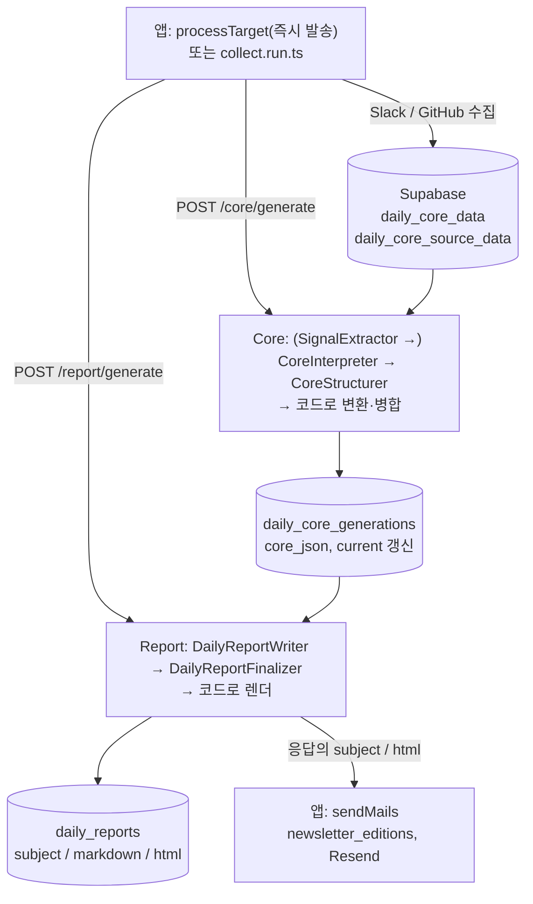

# ieum-flue

Daily Core와 Daily Report를 만드는 Cloudflare Worker입니다. Flue(`@flue/runtime`) 런타임 위에서 Agent를 순서대로 호출합니다. 호출 순서는 코드가 정하고, 모델은 각 단계 안에서 판단만 합니다. 수집과 메일 발송은 앱 쪽이 하고, 이 Worker는 수집된 데이터를 읽어 Core를 만들고, Core에서 리포트를 만들어 저장합니다.

배포 주소는 `https://ieum-flue.jinu30dev.workers.dev`입니다. 앱은 아직 로컬에서만 돌고(Vercel 배포는 `works/vercel-deploy.md`), 루트 `.env`의 `FLUE_BASE_URL`로 이 주소를 부릅니다.

## 전체 흐름



앱의 메일 경로(`processTarget`)는 수집 뒤 `app/features/daily-core/flue.ts`로 `/core/generate` → `/report/generate`를 차례로 부르고, 리포트 응답의 `subject` / `markdown` / `html`을 메일로 보냅니다. 메일은 daily core(Target × 날짜)당 1통이며, 그 판정은 앱과 DB(`newsletter_editions`)가 합니다. Worker는 메일을 모릅니다.

### Core (`/core/generate`)

| 단계 | 누가 | 하는 일 |
|---|---|---|
| 0. 수집 | 앱 `processTarget` / `app/features/daily-core/collect.run.ts` | Slack과 GitHub를 날짜 창 기준으로 모아 정규화하고 `daily_core_source_data.normalized_json`에 저장 |
| 1. 읽기 | `app.ts` | Supabase REST(service role 키)로 `daily_core_data`와 수집 행을 읽음 |
| 2. 입력 만들기 | `buildAgentInput` (코드) | 스레드를 묶고, 날짜 창 이전의 부모는 `(context)`로 표시, 봇 알림은 뺌(답글이 있는 부모는 유지). 각 줄에 ref(`S001`…)를 붙이고, ref별 작성자 표와 사람 목록을 만듦 |
| 3. generation 행 생성 | `app.ts` | `processing` 상태로 만들고 파이프라인·프롬프트 버전, 모델, 입력 행 id를 기록 |
| (선택) Call 0 | `SignalExtractor` (모델) | target의 `pipeline_options`가 `{"signals": true}`일 때만. 한 일에 관한 모든 출처 줄을 한 subject 아래 시간순 signal(refs, kind, subject, fact, quote?)로 모으고, Call 1은 원문 대신 그 목록을 읽음(`signalsBody`, 지시문의 입력 설명 문단만 바꿈). quote는 인용한 줄에 실제로 있을 때만 넘김. `pipeline_version`에 `+signals` |
| 4. Call 1 | `CoreInterpreter` (모델) | 하루를 사건 단위 core item으로 묶음. item마다 actor와 `next_step`(근거가 있을 때만, 없으면 null) |
| 5. Call 2 | `CoreStructurer` (모델) | core item을 highlights / topics / progress_roadmap / member_activity에 배치하고 overview를 씀 |
| 6. 변환·병합 | `resolveStructuring`, `buildCoreJson` (코드) | core item id를 근거 ref로 바꾸고(멤버는 본인이 쓴 줄만) importance, `payload.owners` / `payload.next_steps`를 core item에서 채움. tags / classifications / entities / confidence는 빈 값(`core-interpreter-v11`부터 모델이 안 만듦, `taxonomy_version: none`). ref를 원본 항목(id, 시각, url, 작성자, 200자 `excerpt`)으로 바꾸고 meta, metrics, quality를 붙임 |
| 7. 저장 | `app.ts` | `core_json`, 단계별 원출력, 토큰, 시간, 반려 이유, stats를 저장하고 `succeeded`와 current를 갱신. 실패하면 `failed`로 남기고 current는 그대로 |

### Report (`/report/generate`)

| 단계 | 누가 | 하는 일 |
|---|---|---|
| 1. 읽기 | `app.ts` | `daily_core_data.current_generation_no`가 가리키는 generation의 `core_json`. current가 없으면 409 |
| 2. 입력 만들기 | `writerInput`, `draftEvidence` (코드) | 이벤트 섹션(highlights / progress_roadmap / topics)의 item에 짧은 id(`H1`, `P1`, `T1`, 섹션 안에서 중요도 순)를 붙이고 담당자·다음 단계·인용 후보를 붙임. 인용 후보는 사람이 쓴 줄의 `excerpt`에서 Slack 마크업을 지우고 15~120자, 하루 보고 양식은 뺌 |
| 3. report 행 생성 | `app.ts` | `daily_reports`에 다음 `report_no`, `processing` |
| 4. Writer | `DailyReportWriter` (모델) | 오프닝, 今日のポイント(최대 3줄), 섹션별 entry(제목, 본문, 근거 `item_ids`, highlights의 `quote_ids`), 마무리 |
| 5. Finalizer | `DailyReportFinalizer` (모델) | Writer 초안을 읽기 쉽게 고침. 문장뿐 아니라 entry·point를 합치고 나누고 순서를 바꿀 수 있음. Writer가 다룬 item은 빠지면 안 됨. 실패하면 Writer 초안으로 렌더하고 이유를 남김(아래 7). `finalize: false`면 건너뜀 |
| 6. 렌더 | `renderDailyReport` (코드) | 섹션 틀, 상태 아이콘, 근거 링크, 인용 원문, 멤버 섹션, 숫자(今日のKPI)를 코드가 붙여 제목 / markdown / 메일 HTML을 만듦 |
| 7. 저장 | `app.ts` | 렌더 결과, 초안(`agent_output_json.draft`, Finalizer를 거쳤으면 `writer_draft`도), 토큰, 시간, stats를 저장하고 `succeeded`. Finalizer가 실패했으면 `validation_json.stats.finalizer_error`와 응답의 `finalizerError`에 이유를 남기고, 앱은 실행 로그에 `report_finalizer_failed` 경고를 씀. 그 밖의 실패는 `failed` |

활동이 없는 날(`quality.status = "empty"`)은 모델을 부르지 않고 코드 렌더만 합니다. 현재 리포트는 따로 가리키지 않고 "가장 큰 `report_no`의 succeeded"로 읽습니다.

## Agent

모든 Agent는 할 수 있는 일이 제출 Tool 하나뿐입니다. 제출 Tool의 입력 스키마가 곧 출력 계약입니다. Tool의 `run`이 코드 검사를 하고, 문제가 있으면 이유와 함께 반려합니다. 모델은 같은 대화 안에서 고쳐 다시 제출합니다. 링크·HTML·상태 아이콘·인용 원문은 모델이 쓰지 않고 코드가 붙입니다.

### Core

| | `CoreInterpreter` (Call 1) | `CoreStructurer` (Call 2) |
|---|---|---|
| 파일 | `src/agents/core/core-interpreter.ts` | `src/agents/core/core-structurer.ts` |
| 입력 | 텍스트로 바꾼 하루 활동 + 오늘 글을 쓴 사람 목록 | Call 1 결과에서 추린 JSON(core item, members, people). evidence ref는 넣지 않음 |
| 제출 Tool | `submit_interpretation` (스키마 `Interpretation`), 필요하면 이어서 `revise_interpretation` 한 번 (스키마 `Revision`) | `submit_daily_core` (스키마 `Structuring`) |
| 반려하는 문제 | 없는 ref, 맥락 줄만 인용, 봇 줄만 인용, concept_key 중복 | 모르는 core item id, 한 core item을 여러 곳에 배치, 사람 목록에 없는 멤버, 본인 줄이 없는 멤버, 같은 사람 중복 |
| 반려 대신 코드가 고치는 것 | 인용한 줄을 쓰지 않은 멤버 actor 제거(`dropUnwrittenActors`), concept_key를 kebab-case로(`normalizeConceptKeys`) | 없음 |
| 제출 뒤 되묻는 것 | 인용 안 된 사람 줄, 중복 후보(두 item만 인용한 줄 2개 이상)(`interpretationReview`). 모델은 바뀐 item만 보내고 코드가 합침(`applyRevision`). 첫 제출도 저장해 두어 수정이 안 오면 그대로 씀 | 없음 |
| 결과 | `useDataWriter("interpretation")` | `useDataWriter("structuring")` |

`SignalExtractor`(`src/agents/core/signal-extractor.ts`, 선택 Call 0)는 `submit_signals`로 제출합니다. 입력은 원문 뒤에 코드가 모은 `## Shared identifiers`(여러 줄이 함께 언급한 `#123` / `ABC-123` / URL과 그 줄들, 묶음이 아닌 힌트)를 붙입니다. 없는 ref는 반려하고, 어느 signal에도 없는 사람 줄은 돌려줘서 `add_signals`로 그 줄만 받습니다. 결과는 `useDataWriter("signals")`, generation의 `agent_output_json.signals`. 프롬프트 DB에서 `core-interpreter` 지시문을 바꿀 때는 입력 설명 문단(`RAW_INPUT`)을 글자 그대로 두어야 합니다. 그 문단을 signal용으로 바꾸므로, 다르면 signals target의 생성이 실패합니다.

target별 선택은 `targets.pipeline_options`(jsonb, 기본 `{}`)입니다. UI에는 없고 운영자가 SQL로 바꿉니다. 다만 RLS상 워크스페이스 admin도 API로 바꿀 수 있습니다.

### Report

| | `DailyReportWriter` | `DailyReportFinalizer` |
|---|---|---|
| 파일 | `src/agents/report/daily-report-writer.ts` | `src/agents/report/daily-report-finalizer.ts` |
| 입력 | target, 날짜, overview, item(id, 섹션, 제목, 요약, 상태, 중요도, 담당자, 다음 단계, 인용 후보) | Writer와 같은 item + Writer 초안 |
| 제출 Tool | `submit_report` (스키마 `ReportDraft`) | `submit_report` (스키마 `ReportDraft`) |
| 반려하는 문제(`draftProblems`) | 모르는 item id, 자기 섹션 item을 인용하지 않은 entry, 인용 안 된 highlight, 입력에 없는 티켓 번호, highlights 밖의 인용, 그 entry의 item이 내놓지 않은 인용 id | 왼쪽 전부 + Writer 초안의 entry가 다룬 item이 빠짐(`coverageProblems`), 제목·포인트 앞의 상태 라벨(【進行中】 등, `labelProblems`). 합치기·나누기·순서 변경은 허용 |
| 반려 대신 코드가 고치는 것 | 없음 | highlights 밖의 인용을 비움(`withoutStrayQuotes`) |
| 결과 | `useDataWriter("draft")` | `useDataWriter("draft")` |

### 지시문·모델·추론 강도

Agent마다 지시문 본문, 모델, `thinkingLevel`, 버전을 프롬프트 DB(별도 Supabase, `PROMPTS_SUPABASE_URL` / `PROMPTS_SUPABASE_KEY`)에서 가져옵니다. 조회는 `src/prompts.ts`의 `resolvePrompts`가 라우트마다 한 번 합니다.

- `prompt_releases`에서 `service_key = 'ieum'`, `agent_key`(`signal-extractor`, `core-interpreter`, `core-structurer`, `daily-report-writer`, `daily-report-finalizer`)의 행을 찾음. `environment`는 `PROMPT_ENVIRONMENT`(배포 `production`은 `wrangler.jsonc`의 `vars`, 로컬 `dev`는 `.dev.vars`) 행을 먼저, 없으면 `default` 행.
- 그 행의 `active_prompt_id`가 가리키는 `prompt_templates`에서 `template`(지시문 본문), `default_provider` + `default_model`(합쳐서 `openai/gpt-5.4-mini` 꼴), `thinking_level`(null이면 `low`), `version`을 씀. `temperature`, `api_mode`, `default_params`, `input_schema`, `output_schema`는 쓰지 않음.
- 행이 없거나 프롬프트 DB가 설정되지 않았거나 조회가 실패(5초 타임아웃 포함)하면 Agent 파일의 코드 기본값(`CORE_INTERPRETER_PROMPT` 등)을 씀. 실패 이유는 Worker 로그에 경고로 남음.
- DB `template`에는 고정 문장만 넣음. 언어 지정과 제출 Tool 호출 두 줄은 실행 값이 필요해서 Agent가 본문 끝에 붙임. 코드 기본값의 `instructions`도 같은 범위.
- 요청 본문의 `model`을 주면 그 요청의 모든 호출이 그 모델을 씀.

호출마다 쓴 모델은 `processing_metrics_json.calls.*.model`에, 행의 `model_provider`/`model_name`에는 쓴 모델들이 기록됩니다(서로 다르면 `prompt_version`처럼 `+`로 이음).

| 버전 | 위치 | 기록되는 곳 |
|---|---|---|
| 파이프라인 `PIPELINE_VERSION` | `app.ts` | generation |
| Core 지시문 ((extractor +) interpreter + structurer) | 프롬프트 DB면 `core-interpreter@v9(default)` 꼴, 코드 기본값이면 `core-interpreter-v8` 꼴 | generation `prompt_version` |
| `core_json` 스키마 `CORE_SCHEMA_VERSION` | `daily-core.ts` | generation |
| 리포트 렌더 `REPORT_FORMAT_VERSION` | `daily-report.ts` | report `format_version` |
| 리포트 지시문 (writer + finalizer) | Core 지시문과 같은 꼴 | report `prompt_version`(저장된 초안을 받았으면 writer 자리에 `given-draft`) |

반려는 재제출마다 모델이 JSON 전체를 다시 내므로 비용이 큽니다. 그래서 `runAgent`가 스트림의 반려(`tool-output-error`, 스키마 실패 포함)를 세다가 `MAX_REJECTIONS`(2)에 이르면 `handle.abort()`로 멈춥니다. 이 경우 generation이나 report는 `failed`가 됩니다.

`TestAgent`(`src/agents/test-agent.ts`)는 한 문장만 만드는 Agent입니다. 앱에서 부르는 곳은 없고, 배포 직후 확인과 새 Flue 기능 시험용으로 남겨 두었습니다.

## 파일

| 파일 | 역할 |
|---|---|
| `src/app.ts` | Hono 라우트, 인증, Supabase 읽기·쓰기, Agent 실행 순서 |
| `src/daily-core.ts` | Core의 모델 바깥 규칙: 입력 만들기, 스키마, 검사, 보정, 변환, `core_json` 병합, 지표 |
| `src/daily-core.check.ts` | 위 규칙의 assert 테스트. 모델 없이 돌아감 |
| `src/daily-report.ts` | `core_json` → Daily Report. Writer 입력·인용 후보·초안 스키마·검사, 렌더(제목, markdown, 메일 HTML. 초안이 있으면 이벤트 섹션을 초안으로 대신함) |
| `src/daily-report.check.ts` | 리포트 규칙·렌더의 assert 테스트 |
| `src/daily-report.run.ts` | 저장된 `core_json`(또는 `/core/generate` 응답)을 `.md` / `.html`로 렌더 |
| `src/core-agent.run.ts` | (시험용) `/core/agent`로 Core Agent 하나를 돌려 `works/out/core-agents/`에 결과 `.json`과 읽기용 `.md`(원문 줄 ↔ signal / item 대조표, Structurer는 섹션별 배치) 저장. `--from`으로 이전 Agent의 `.json`을 다음 Agent 입력으로 |
| `src/agents/core/*.ts`, `src/agents/report/*.ts` | Agent 지시문 코드 기본값과 제출 Tool 연결 |
| `src/prompts.ts` | 프롬프트 DB에서 Agent별 지시문·모델·추론 강도 조회(`resolvePrompts`) |
| `wrangler.jsonc` | Worker 설정과 Durable Object migration(Agent 추가·삭제마다 한 줄) |

## 사용하는 Flue 기능

| 기능 | 쓰는 곳 |
|---|---|
| `"use agent"` + Agent 함수 | Agent 하나가 Durable Object 클래스 하나(`Flue<Name>Agent`)가 됨 |
| `useModel(model, { thinkingLevel })` | 모델과 추론 강도(둘 다 `initialData`로 받음) |
| `useInitialData` | 검사에 필요한 데이터(ref 목록, 작성자 표, 리포트 item id·인용 id, Finalizer의 원래 초안 등) 전달 |
| `useTool` (Valibot 스키마) | 제출 Tool. 스키마 검증 실패는 `run`까지 오지 않고 바로 반려됨 |
| `useDataWriter` | 검사를 통과한 결과를 구조화 데이터로 꺼냄 |
| `useAgentFinish` | 제출 없이 끝내려 하면 제출하라는 신호를 넣음 |
| `useResponseFinish` | 토큰 사용량과 Tool 호출 기록을 메타데이터로 남김 |
| `init` → `dispatch` → `read(onEvent)` | `app.ts`에서 Agent 실행, 반려 이유 수집, 상한 초과 시 `abort()` |
| `createAgentRouter` | `/agents/test` 노출 |

Skill, Subagent, MCP, Sandbox, 데이터 조회 Tool, Workers AI 바인딩은 쓰지 않습니다. 언제 검토할지는 `works/` 아래 TODO(Skill / Subagent 필요 여부, 모델 교체 비교)에 적혀 있습니다.

## 엔드포인트

`GET /` 말고는 모두 Bearer 토큰(`FLUE_API_TOKEN`)이 필요합니다.

| 경로 | 내용 |
|---|---|
| `GET /` | 헬스 체크 |
| `POST /core/generate` | 본문 `{ dailyCoreId, model? }`. 다음 generation을 만들어 저장하고 current로 함. 응답에 stats, 토큰, 호출별 시간·반려 이유, `coreJson` |
| `POST /report/generate` | 본문 `{ dailyCoreId, model?, finalize?, draft? }`. 현재 generation으로 리포트를 만들어 `daily_reports`에 다음 `report_no`로 저장하고 `reportId`, `draft`, `subject`, `markdown`, `html`, stats, 토큰을 응답. 기본으로 Finalizer까지 돌고(응답에 `writerDraft`, Finalizer가 실패해 Writer 초안을 썼으면 `finalizerError`), `finalize: false`면 Writer만. `draft`(저장된 Writer 초안)를 주면 Writer를 건너뜀. 현재 generation이 없으면 409(행 안 만듦) |
| `POST /core/agent` | (시험용) 본문 `{ dailyCoreId, agent, model?, signals?, interpretation? }`. `agent`(`extractor` / `interpreter` / `structurer`) 하나만 돌려 출력·토큰·반려와 모델이 본 입력 원문을 응답. DB 기록 없음, target의 `pipeline_options`는 안 봄. `interpreter`는 `signals`를 주면 원문 대신 그것을 읽고, `structurer`는 `interpretation`이 필요(그날 ref와 안 맞으면 400). Structurer는 `structuring`과 함께 코드 변환 뒤 `coreJson`·stats도 응답 |
| `/agents/test/*` | `TestAgent`(한 문장 생성, DB 기록 없음) |

## 실행과 배포

```sh
npm run dev                            # 로컬 Worker, http://localhost:8787
npx tsx src/daily-core.check.ts        # 규칙 테스트 (flue/ 에서)
npx tsx src/daily-report.check.ts      # 리포트 규칙·렌더 테스트
npx tsx src/daily-report.run.ts <core.json> <out> [report.json]   # 리포트 미리보기 파일
npx tsx src/core-agent.run.ts --agent <extractor|interpreter|structurer> --label <name> [--runs 3] [--id <dailyCoreId>] [--from <이전 결과 .json>]   # Core Agent 하나 실행·저장 (로컬 Worker 필요)
npx tsc --noEmit -p .                  # 타입 검사
npm run deploy                         # vite build + wrangler deploy
```

- 로컬 시크릿은 `.dev.vars`: `OPENAI_API_KEY`, `FLUE_API_TOKEN`, `SUPABASE_URL`, `SUPABASE_SERVICE_ROLE_KEY`, `PROMPTS_SUPABASE_URL`, `PROMPTS_SUPABASE_KEY`, `PROMPT_ENVIRONMENT=dev`. 배포용 `CLOUDFLARE_API_TOKEN`, `CLOUDFLARE_ACCOUNT_ID`도 여기 둠.
- 배포본 시크릿은 `wrangler secret put`으로 등록. 배포 방법은 `works/env.md`.
- 앱이 로컬 Worker를 부르게 하려면 루트 `.env`의 `FLUE_BASE_URL`을 지우고 앱을 재시작(없으면 `http://localhost:8787`).
- 모델 제공자 키는 Flue가 환경변수에서 찾음(`openai/...` → `OPENAI_API_KEY`). 코드에서 넘기지 않음.
- Agent를 추가·삭제하면 `wrangler.jsonc` migrations에 `new_sqlite_classes` / `deleted_classes`를 한 줄 추가.
- 배포 직후 잠깐은 이전 버전이 응답할 수 있음(라우트가 없으면 평문 `404 Not Found`).

## 아직 연결되지 않은 것

- 매일 자동으로 도는 Cron. 지금은 앱의 즉시 발송이 수집 → Core → 리포트 → 메일을 한 번에 돌리지만, 날짜는 `target-processing.ts`의 `DAILY_CORE_TEST_DATE`(테스트용 임시 고정 날짜)로 고정.
- `core_json`을 `daily_core_items`, `daily_core_metrics` 테이블로 푸는 projection.
- Supabase 쓰기는 REST로 순서대로 함(트랜잭션 없음). 중간에 죽으면 generation이나 report가 `processing`으로 남음.
- 실패한 행의 `error_message`에는 원인이 잘 안 남음(대부분 "[flue] Agent run failed").
